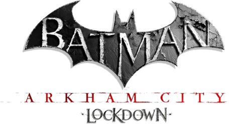
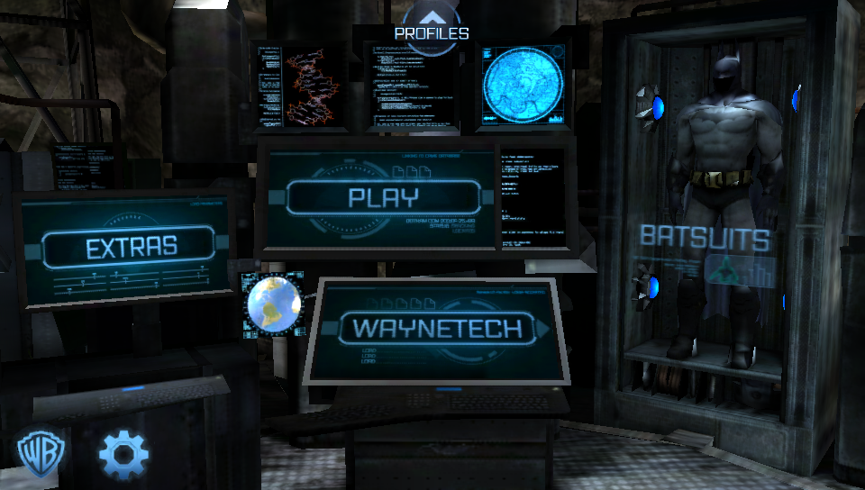
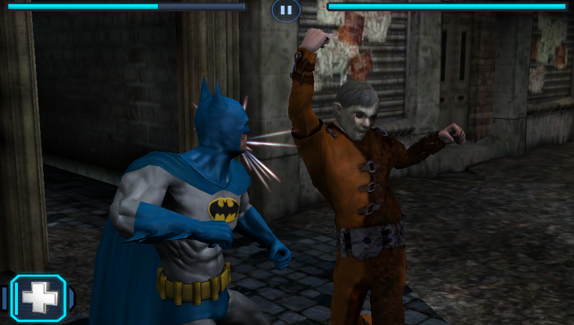
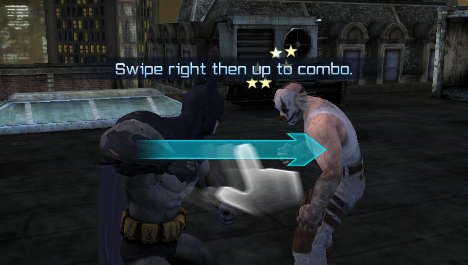

<p align="center">
  
</p>

---

A port of the Android version of Batman: Arkham City Lockdown to the PS Vita.
It runs the game's original code natively, nothing is emulated.

> [!IMPORTANT]
> **No game files are included here or in the release.** You need your own copy of the Android
> game, version 1.0.2.

<p align="center">
  
  
</p>

## Download & Install

Grab `aclockdown.vpk` from the [Releases](../../releases) page and install it with VitaShell. You
need a Vita with HENkaku/Ensō, plus two things most people already have:

* [kubridge](https://github.com/bythos14/kubridge/releases): put `kubridge.skprx` in `ur0:tai/`,
  add it under `*KERNEL` in `ur0:tai/config.txt` and reboot.
* `libshacccg.suprx`, installed with [ShaRKBR33D](https://github.com/Rinnegatamante/ShaRKBR33D/releases).
  The game's shaders get compiled on the Vita with it.

Then the game files. You need two files from your Android copy (version 1.0.2):
`libUnrealEngine3.so` from the APK (it's in `lib/armeabi-v7a/`) and the expansion file from
`Android/obb/com.wb.goog.ArkhamCity/`. Make a folder called `aclockdown` in `ux0:data/` and copy
them in, like this:

```
ux0:data/
└── aclockdown/
    ├── libUnrealEngine3.so
    └── main.2.com.wb.goog.ArkhamCity.obb
```

Keep the names exactly as they are. The OBB is only read, never modified.

The first boot takes about two minutes on a black screen. That's the Vita compiling the game's
shaders, and it only happens once (they're cached in `shader_cache/`). After that it reaches the
menu in about 15 seconds. The intro movie at boot can be skipped with any button.

Saves, settings and the log (`log.txt`) all go to `ux0:data/aclockdown/`.

## Controls

The game is touch only, so every button is turned into a touch. The touchscreen works as it is,
use whichever you like.

| Vita | Does |
|---|---|
| Square | Strike (swipes at the enemy, toward the left stick if you hold it) |
| Triangle | Counter (taps the counter circle when one shows up, otherwise dodges) |
| Circle / Cross | Swipe down / up, to finish combos (Square, Square, Circle is a combo) |
| D-Pad / Right stick | Swipe in that direction |
| L / R | First and second ability (L is the health boost) |
| Start | Pause |
| Tilt / Left stick | Steer the flying batarang |

The mapping lives in `ux0:data/aclockdown/controls.txt`, written the first time you play. Each
line is a button and what it does, with spots on the screen in 960x544, so you can move things
around:

```
SQUARE strike
CIRCLE swipe 480 160 0 220
L tap 64 500
```

Delete the file to get the defaults back.

## What's different from the phone version

* **Batsuits cost WayneTech points instead of real money.** Every suit is 1000 WT, the shop shows
  what you have.
* **A few settings in `config.txt`**, next to the other files: `unlock_suits 1` gives you every
  suit for free, `intro_movie 0` skips the intro, `tilt 0` turns off steering the batarang by
  tilting the Vita (the left stick always works) and `tilt_sensitivity` sets how much you need to
  tilt.
* **The comic in Extras works**, the port has its own viewer for it.
* **The online stuff is gone.** There's no network on this port, so you'll see a "no connection"
  message at the menu. Everything else plays offline.

<p align="center">
  
</p>

## AI Assistance

Parts of the code were written or improved with the assistance of AI (Claude, by Anthropic). That
includes a good part of the port itself: the Android shims, the memory and loading fixes, the
movie player, the comic viewer, the controls, tilt and the batsuit shop. All AI-assisted code was
reviewed, tested, and manually validated, with the overall implementation and debugging process
remaining under human supervision.

## Credits

* **NetherRealm Studios and WB Games** for Batman: Arkham City Lockdown. This project isn't
  affiliated with them.
* **so_util** and the **so-loader boilerplate** by Andy Nguyen, Rinnegatamante and Volodymyr
  Atamanenko.
* **FalsoJNI** by Volodymyr Atamanenko.
* **vitaGL** and **vitaShaRK** by Rinnegatamante.
* **kubridge** by bythos.
* **libdeflate** by Eric Biggers, makes the loading faster.
* **stb_vorbis** and **stb_image** by Sean Barrett, play the sounds and show the comic.
* **VitaSDK** and the Vita homebrew scene.

## Building from source

The Android library uses the softfp ABI, so you need [VitaSDK softfp](https://github.com/vitasdk-softfp)
with these packages from its vdpm: `zlib kubridge vitaShaRK libmathneon vitaGL libogg libvorbis SceShaccCgExt taihen`.

Packages are decoded with [libdeflate](https://github.com/ebiggers/libdeflate): unpack its release
tarball (1.26) next to the repo as `../tools/libdeflate-1.26`, or point `-DLIBDEFLATE_DIR=` at it.
Then:

```bash
git clone --recursive <this repo>
cd <repo>
cmake -S . -B build
cmake --build build
```

The VPK ends up in `build/aclockdown.vpk`. vitaGL and vitaShaRK are built from the submodules. A
few options that help when something breaks:

* `-DDEBUG_SHOTS=ON` logs the frame rate every 5 seconds and SELECT saves a screenshot
  (`shot.raw`).
* `-DPERF_TRACE=ON` logs frame times, draw calls, loading and per-thread CPU every second.
* `-DLEAK_TRACE=ON` tracks the engine's allocations and prints who holds the most memory at every
  loading screen.
* `-DHANG_DUMP=ON` crashes the game on purpose if it stops for 30 seconds, so you get a coredump
  that shows where it got stuck.
* `-DVERBOSE_LOG=ON` logs every file access and JNI call.
* `-DVITA3K=ON` loads the library without kubridge so it runs in Vita3K.

### How it works, roughly

* `main.c` replays what the Java side of the Android app does at startup, in the same order, then
  feeds touch and buttons in.
* `jni_impl.c` answers the engine's calls into Java. EGL is vitaGL, the expansion file is read
  straight from `ux0:data`.
* `audio.c` replaces the Android sound and music players, `movie.c` plays the intro with
  sceAvPlayer and `comic.c` shows the comic.
* `bionic.c` makes the Android C library calls work. Big allocations get their own memory blocks
  and the compressed packages are read from the OBB on demand, because the Vita's heap was too
  small and too fragmented for how the engine uses memory.
* `zfast.c` decodes packages with libdeflate, and works around the engine leaking a zlib state
  every time it rereads a package.
* `patch.c` fixes two slowdowns in the engine (lighting updated every frame in fights, cutscene
  scale tracks) and skips a 16 second cache cleanup at boot. `store.c` is the batsuit shop and
  `tilt.c` the motion sensor.
